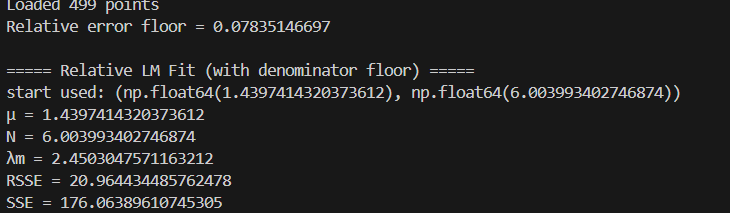
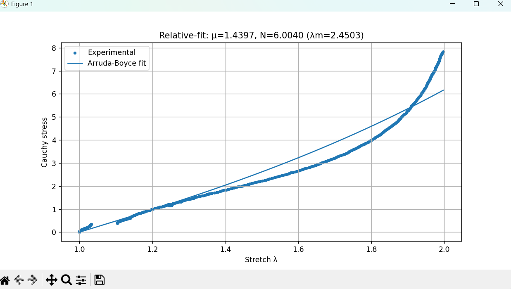

# ElastomerFit — Arruda–Boyce Hyperelastic Relative Fitting

This Python project implements a fifth-order Arruda–Boyce hyperelastic model and a custom **Levenberg–Marquardt (LM) fitting routine** to compare the model with experimental uniaxial Cauchy-stress data. It uses **relative least squares with a denominator floor**, an **analytic residual Jacobian**, **adaptive diagonal damping** and **120 random starting points**. The parameters in the script are μ and N, with λm calculated as √N.

The objective is to select material parameters using relative differences between calculated and measured stresses. The repository presents the original implementation and supplied output; it does not claim an exact match to all experimental points.

**The experimental data are after removal of the Mullins effect, as specified by the project author.** This repository contains the supplied data; the removal procedure is not part of this script.

## Main concepts implemented

| Concept | Role in this code |
|---|---|
| Fifth-order Arruda–Boyce model | Computes nonlinear hyperelastic Cauchy stress from stretch and two material parameters. |
| Incompressible uniaxial formulation | Uses the invariant `I1 = λ² + 2/λ` and the stress factor `λ² − 1/λ`. |
| Relative least-squares objective | Divides each stress residual by a data-dependent denominator before summing its square. |
| One-percent denominator floor | Prevents division by zero and limits the weighting of very small stresses. |
| Analytic Jacobian | Calculates residual sensitivities to μ and N directly from the model equations. |
| Levenberg–Marquardt routine | Forms a damped normal-equation system to calculate trial parameter updates. |
| Adaptive diagonal damping | Scales the normal-matrix diagonal and adjusts damping according to trial acceptance. |
| Parameter projection | Applies lower limits to μ and N after each trial update. |
| Log-uniform multistart search | Samples 120 initial parameter pairs across the specified ranges. |
| Reproducible initialization | Uses NumPy's random generator with seed 0. |
| Minimum-RSSE selection | Retains the parameter pair with the smallest returned relative objective. |
| Separate absolute-error reporting | Reports SSE alongside the relative objective RSSE. |
| Experimental/model visualization | Displays measured points and a model curve evaluated on an 800-point stretch grid. |

## Parameters and symbols

| Symbol | Meaning |
|---|---|
| λ | Axial stretch, taken from the CSV column named `Strain`. |
| y | Experimental Cauchy stress. |
| σ | Cauchy stress calculated by the Arruda–Boyce equation. |
| μ | Stress-scale coefficient in the implemented Arruda–Boyce model; has the input stress unit. |
| N | Dimensionless chain parameter used in the polynomial terms. |
| λm | Chain limiting-stretch parameter, calculated as √N. |
| I1 | First strain invariant for the incompressible uniaxial formulation. |
| r | Vector of floored relative residuals. |
| J | Jacobian of the relative residuals with respect to μ and N. |
| η | LM damping parameter, named `damp` in the script. |

## Calculation workflow

1. Read the experimental CSV and extract stretch and Cauchy stress.
2. Retain finite pairs of data values and calculate the denominator floor.
3. Draw 120 log-uniform initial pairs for μ and N.
4. For each pair, evaluate the model, residuals and analytic Jacobian inside the LM routine.
5. Form the damped system, solve for a trial update and project the trial parameters to their lower limits.
6. Accept a trial only when its RSSE decreases; adjust damping and continue until the stopping rule or iteration limit is reached.
7. Select the returned result with the smallest RSSE across the 120 starts.
8. Calculate λm and absolute SSE, print the numerical output and display the comparison plot.

## Files

- `main_relative_cor.py`: original Python code, unchanged.
- `Exp_dataWM.csv`: supplied experimental data, unchanged in content.
- `output_console.png`: supplied numerical output screenshot.
- `output_plot.png`: supplied experimental-versus-model plot screenshot.
- `README.md`: project description and formulas appearing in the code.

## Experimental data

The CSV contains 499 points with two columns:

| Column | Interpretation in the code |
|---|---|
| `Strain` | Stretch λ |
| `Cauchy-stress` | Experimental Cauchy stress y |

The stress unit is not specified in the supplied CSV. The script retains rows where both values are finite.

## Formulas used in the code

### Arruda–Boyce stress

$$I_1=\lambda^2+\frac{2}{\lambda},\qquad S=\lambda^2-\lambda^{-1}.$$

$$a_1=\frac1{10},\quad a_2=\frac{11}{350},\quad a_3=\frac{19}{1750},\quad a_4=\frac{519}{134750}.$$

$$B=\frac12+a_1\frac{I_1}{N}+a_2\frac{I_1^2}{N^2}+a_3\frac{I_1^3}{N^3}+a_4\frac{I_1^4}{N^4}.$$

$$\sigma(\lambda;\mu,N)=2\mu SB,\qquad \lambda_m=\sqrt N.$$

### Relative residual and error measures

$$y_{floor}=0.01\max_i|y_i|,\qquad d_i=\max(|y_i|,y_{floor}).$$

$$r_i=\frac{y_i-\sigma_i}{d_i},\qquad RSSE=\sum_i r_i^2,\qquad SSE=\sum_i(y_i-\sigma_i)^2.$$

The denominator floor limits the weighting of zero and very small experimental stresses. It is calculated once from the experimental data and remains fixed during fitting. When an experimental stress is below the floor, the scaled residual is not a literal percentage error.

**RSSE is the objective used for fitting and selecting the result. SSE is calculated afterward to report absolute stress mismatch.** A lower relative objective does not guarantee a smaller absolute error at every point.

### Analytic residual Jacobian

For the unscaled residual $e=y-\sigma$:

$$\frac{\partial B}{\partial N}=-a_1\frac{I_1}{N^2}-2a_2\frac{I_1^2}{N^3}-3a_3\frac{I_1^3}{N^4}-4a_4\frac{I_1^4}{N^5}.$$

$$\frac{\partial e}{\partial\mu}=-2SB,\qquad \frac{\partial e}{\partial N}=-2\mu S\frac{\partial B}{\partial N}.$$

Each row is divided by its denominator to form the relative-residual Jacobian:

$$J_{i,:}=\frac{(J_{abs})_{i,:}}{d_i}.$$

### Levenberg–Marquardt (LM) routine as written in the original code

Levenberg–Marquardt is a damped nonlinear least-squares approach. The Jacobian supplies the local sensitivities, while damping modifies the update system. Here the damping term uses the diagonal of $J^TJ$, rather than an identity matrix. Larger damping suppresses the proposed update; smaller damping moves the system toward its undamped form.

For $p=(\mu,N)^T$ and damping η, the supplied script computes:

$$H=J^TJ,\quad g=J^Tr,\quad D=\operatorname{diag}(\operatorname{diag}(H)),\quad A=H+\eta D.$$

$$A\Delta p=g,\qquad p_{trial}=p+\Delta p.$$

These equations describe the uploaded implementation exactly, including the update sign; the solver has not been modified or independently validated in this package. The results below are the supplied outputs, not a claim of a verified optimum.

The trial parameters are restricted using:

$$\mu_{trial}\leftarrow\max(\mu_{trial},10^{-12}),\qquad N_{trial}\leftarrow\max(N_{trial},1).$$

A trial is accepted if its RSSE decreases. Damping is divided by 10 on acceptance and multiplied by 10 on rejection or a singular solve. An accepted objective change below $10^{-12}$ ends that run. If the linear solve raises `LinAlgError`, the code increases damping and continues. The per-start iteration limit is 250; reaching that limit returns the current parameters.

These parameter projections preserve a positive μ and keep N at least one. They are numerical lower limits; the initialization ranges are not enforced as upper bounds on the final parameters.

### Random starting parameters

$$\mu_{start}=\exp\left(U(\ln10^{-4},\ln50)\right),\qquad N_{start}=\exp\left(U(\ln1,\ln500)\right).$$

Here $U(a,b)$ denotes a uniform random draw. The script uses seed 0 and 120 starts, selecting the result with the smallest returned RSSE. The initial damping is 0.01 and each run allows up to 250 iterations. The intervals above are sampling ranges for starting values.

## Settings used in the supplied code

| Setting | Value |
|---|---|
| CSV filename | `Exp_dataWM.csv` |
| Stretch column | `Strain` |
| Stress column | `Cauchy-stress` |
| Random seed | 0 |
| Number of random starts | 120 |
| Initial μ sampling range | 0.0001–50.0 |
| Initial N sampling range | 1.0–500.0 |
| Initial LM damping | 0.01 |
| Maximum iterations per start | 250 |
| Accepted objective-change tolerance | 1e-12 |
| Denominator floor fraction | 0.01 of maximum absolute experimental stress |
| Projected μ minimum | 1e-12 |
| Projected N minimum | 1.0 |
| Model plotting grid | 800 points from minimum to maximum retained stretch |

Multistart reduces dependence on a single initial guess, but does not establish a global optimum. The stopping rule checks the absolute change in RSSE on accepted trials; it is not a parameter-uncertainty estimate.

## Supplied outputs

The following values are transcribed from the supplied console screenshot, rather than from a modified version of the code:

| Quantity | Supplied value |
|---|---:|
| Points loaded | 499 |
| Relative error floor | 0.07835146697 |
| μ | 1.4397414320373612 |
| N | 6.003993402746874 |
| λm | 2.4503047571163212 |
| RSSE | 20.964434485762478 |
| SSE | 176.06389610745305 |

